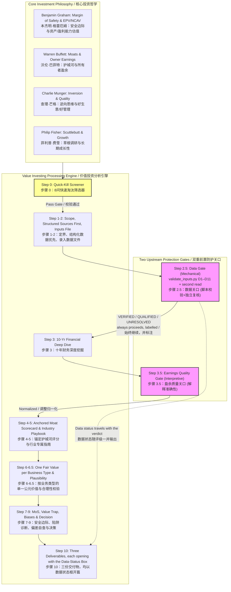
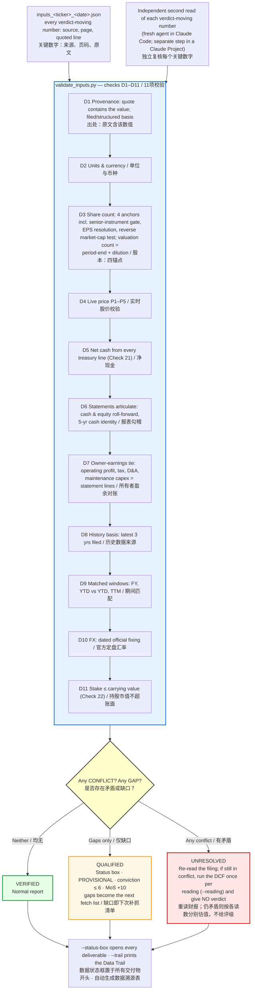
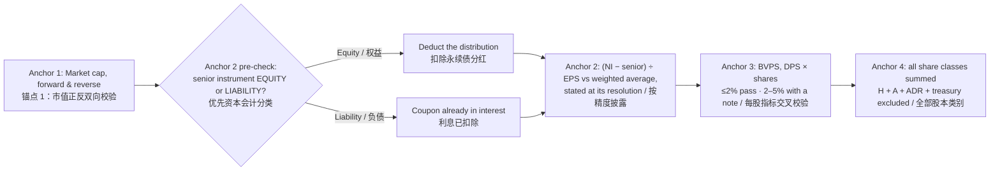
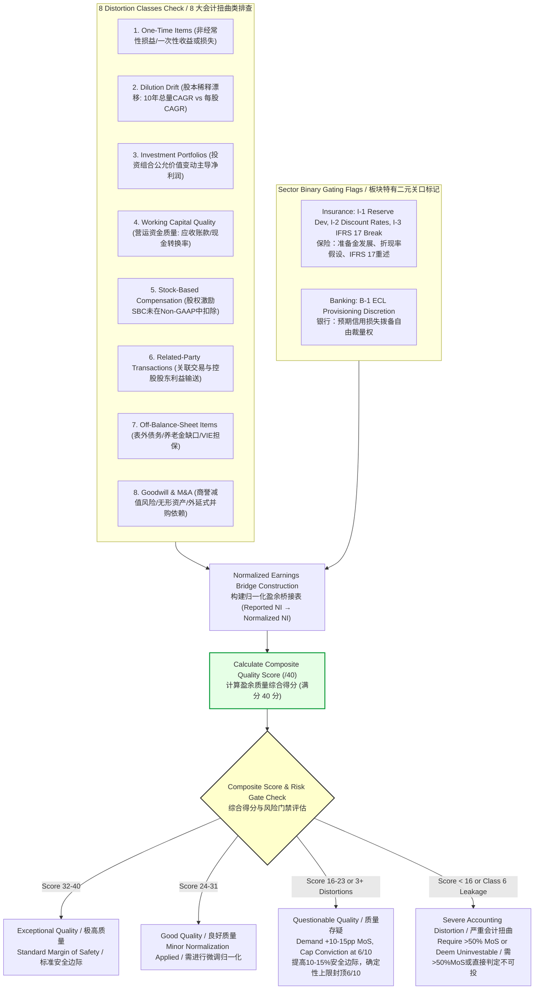
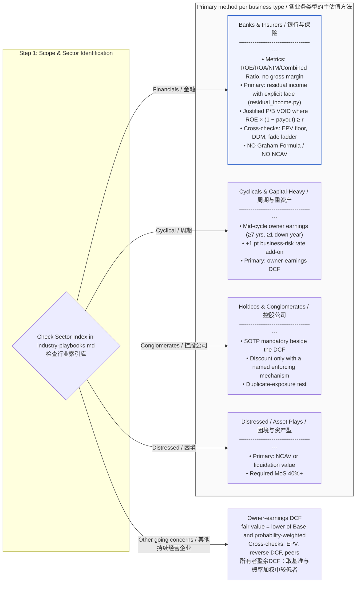
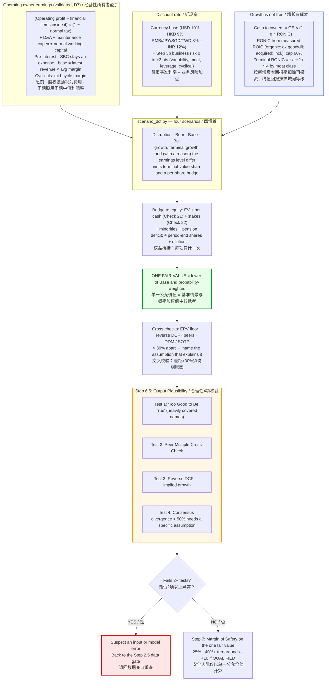
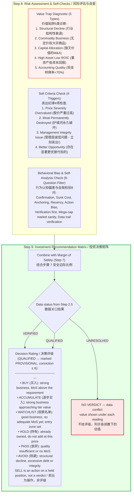
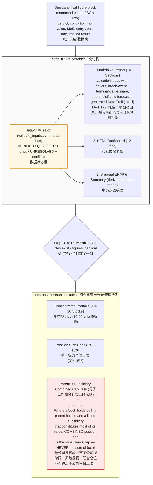

# Value Investing Skill Architecture & Workflow Specification
# 价值投资 Research Skill 架构与工作流程图解指南 (中英双语版)

> **Document Version**: 2026-11-10 (Data gate with three outcomes; valuation method rebuilt)  
> **Target Skill**: `value-investing`  
> **Core Philosophy**: Benjamin Graham, Warren Buffett, Charlie Munger, Philip Fisher  
> **Supersedes**: 2026-07-27 version (Post-Amendment #13)

**What changed since the 2026-07-27 version / 本版主要变化**

| Area / 领域 | Before / 之前 | Now / 现在 |
|---|---|---|
| Step 2.5 | Four anchors checked by hand; any failure stopped the analysis / 四锚点人工核对，任一失败即中断 | `validate_inputs.py` runs 11 checks (D1–D11) on an inputs file, plus an independent second read; outcome **VERIFIED / QUALIFIED / UNRESOLVED** — the analysis is always produced / 脚本化11项校验+独立复核；三种结果，分析始终输出 |
| Owner earnings / 所有者盈余 | Net income + D&A − maintenance capex (three conflicting definitions) / 以净利润为起点，三种口径并存 | Operating profit × (1 − tax) + D&A − maintenance capex, pre-interest, SBC not added back / 以经营利润为起点、税后、息前，不加回股权激励 |
| Growth / 增长 | Free / 增长无成本 | Charged at g ÷ RONIC; terminal RONIC by moat (r / r+2 / r+4) / 按 g ÷ 新增资本回报率扣除再投资 |
| Fair value / 公允价值 | Multi-method triangulation with free weights / 多方法自由加权 | One figure from the primary method per business type; others are cross-checks / 按业务类型取单一主方法，其余仅作交叉校验 |
| Financials / 金融 | P/B to ROE | Residual income with explicit fade (`residual_income.py`) / 带衰减的剩余收益模型 |
| Verdicts / 评级 | BUY / ACCUMULATE / MONITOR / PASS / SELL / AVOID | BUY / ACCUMULATE / WATCHLIST / HOLD / PASS / AVOID; SELL is an action / SELL为操作而非评级 |

---

## 1. System Architecture & Core Philosophy / 系统架构与核心哲学

The `value-investing` skill is built upon a fundamental principle: **protect downstream valuation and decision-making by enforcing strict upstream data integrity and quality gates**.

本技能的核心设计理念为：**通过设立严密的上游数据勾稽与盈余质量关口，确保下游的估值模型与投资决策建立在真实、未受扭曲的基础之上**。

---

## 2. End-to-End Research Workflow / 端到端研究流程

The standard research procedure runs Steps 0 through 10.5. The data gate (2.5) no longer stops the analysis: it decides how frankly the result must be labelled. Step 3.5 still raises the bar on distorted earnings, and Step 6.5 still loops back when the output looks implausible.

标准研究流程为步骤 0 至 10.5。数据关口（2.5）不再中断分析，而是决定结果须如何如实标注；步骤 3.5 仍对扭曲盈余提高门槛；步骤 6.5 在结果异常时仍回溯核查。

```mermaid
flowchart TD
    S0["Step 0: Quick-Kill Screener<br>8-Question Gate / 8问快速淘汰筛选"] -->|Pass / 通过| S1["Step 1: Identify & Scope<br>Name, Ticker, Exchange, Currency, Sector / 确定标的、范围与行业"]
    S0 -->|Fail Q7 Integrity Veto / 诚信否决| VETO["AUTOMATIC VETO / 自动一票否决<br>Pass & Move On / 放弃并跳过"]
    S0 -->|4+ 'No' Answers / 4项以上否定| VETO

    S1 --> S2["Step 2: Data Collection<br>Structured sources first; latest 3 yrs tied to filings;<br>every number + page + quoted line → inputs file<br>结构化数据优先；近3年对照原始财报；逐项录入数据文件"]
    S2 --> S25{"Step 2.5: Data Gate<br>validate_inputs.py D1–D11 + independent second read<br>数据关口：脚本校验 + 独立复核"}

    S25 -->|No gap, no conflict| V["VERIFIED<br>Normal report / 正常报告"]
    S25 -->|Gaps only / 仅有缺口| Q["QUALIFIED<br>Verdict PROVISIONAL · conviction ≤ 6/10 · MoS +10 pts<br>评级标注暂定 · 确定性≤6 · 安全边际+10个百分点"]
    S25 -->|A conflict / 存在矛盾| U["UNRESOLVED<br>Try to resolve first; else value under each reading, NO verdict<br>先尝试化解；否则按各读数分别估值，不给评级"]
    U -.->|Resolved by re-reading the filing / 重读财报化解| S2

    V --> S3["Step 3: Financial Analysis<br>10-Yr Financial Table & Metrics / 10年财务数据与比率分析"]
    Q --> S3
    U --> S3
    S3 --> S35{"Step 3.5: Earnings Quality Gate<br>盈余质量关口 (8 Distortion Classes)"}

    S35 -->|Composite Score < 16 or Leakage / 质量低| HIGH_RISK["Require >50% MoS or Consider Uninvestable<br>要求>50%安全边际或直接判定不可投"]
    S35 -->|Normalized Financials / 完成盈余归一化| S4["Step 4: Moat Assessment<br>Anchored /30 Scorecard, Durability & Trend / 锚定评分、耐久度与趋势"]
    HIGH_RISK --> S4

    S4 --> S5["Step 5: Industry Analysis & Playbook<br>Sector Playbooks & Avoid Lists / 行业专属指南与规避清单"]
    S5 --> S6["Step 6: Intrinsic Valuation<br>One fair value from the primary method / 主方法得出单一公允价值"]

    S6 --> S65{"Step 6.5: Plausibility Checks<br>估值合理性回溯校验 (4 Sanity Tests)"}
    S65 -->|Fail 2+ Tests / 2项以上异常| FAIL65["Model Error Suspected! Re-check inputs<br>怀疑模型错误！退回数据关口重查"]
    FAIL65 --> S25

    S65 -->|Plausible / 校验合理| S7["Step 7: Margin of Safety<br>Price vs the one fair value / 价格对照单一公允价值"]
    S7 --> S8["Step 8: Risk & Sell Check<br>Value Traps, Inflation, Biases / 价值陷阱诊断、宏观与偏差自查"]
    S8 --> S9["Step 9: Investment Decision<br>BUY / ACCUMULATE / WATCHLIST / HOLD / PASS / AVOID<br>(PROVISIONAL if QUALIFIED; none if UNRESOLVED)"]
    S9 --> S10["Step 10: Report Generation<br>Report · Dashboard · Bilingual Summary, each with the Data-Status Box<br>报告、仪表盘、双语摘要，均附数据状态框"]
    S10 --> S105{"Step 10.5: Deliverable Gate<br>交付物关口: manifest + canonical figures match"}

    style S25 fill:#ffe6e6,stroke:#ff0000,stroke-width:2px
    style S35 fill:#ffe6e6,stroke:#ff0000,stroke-width:2px
    style S65 fill:#fff0c2,stroke:#ff9900,stroke-width:2px
    style V fill:#e6ffe6,stroke:#009933,stroke-width:2px
    style Q fill:#fff7e6,stroke:#ff9900,stroke-width:2px
    style U fill:#ffe6e6,stroke:#cc0000,stroke-width:2px
    style VETO fill:#ffcccc,stroke:#999999,stroke-width:2px
```

---

## 3. Upstream Protection Gates Detailed Flow / 双重前置防护关口详细流程

### 3.1 Step 2.5: The Data Gate / 数据关口

Step 2.5 protects against transcription and scale slips, aggregator errors, dual-listing price-basis traps, hybrid capital distortions, stale quotes, missing treasury lines and mismatched windows. Every verdict-moving number carries its source, page and the line as printed; the script checks the arithmetic and a second, independent read checks the transcription. Each failed check is either a **GAP** (not read / not explained) or a **CONFLICT** (two figures disagree).

步骤 2.5 防范誊录与单位错误、第三方数据源错误、双重上市价格基准陷阱、永续债/AT1 导致的股本扭曲、过期报价、遗漏的现金类科目以及期间口径错配。每个关键数字均记录出处、页码与原文；脚本核对勾稽，独立复核核对誊录。每项未通过的校验归为 **缺口（GAP）** 或 **矛盾（CONFLICT）**。

The four anchors are still the heart of D3 / 四锚点仍是 D3 的核心:

---

### 3.2 Step 3.5: Earnings Quality Gate & 8 Distortions / 盈余质量关口与 8 大扭曲类

Step 3.5 transforms accounting numbers into true **Economic Owner Earnings**.

步骤 3.5 将会计层面披露的净利润转换为反映商业本质的**经济所有者盈余**。

---

## 4. Sector Playbook Override & Early Loading Logic / 行业专属指南覆盖逻辑

The skill identifies the sector in **Step 1** and loads the overrides from `references/industry-playbooks.md` before the financial table and the valuation method are chosen.

技能在**步骤 1**识别行业，并在构建财务表与选择估值方法之前载入 `references/industry-playbooks.md` 中的覆盖规则。

---

## 5. Valuation Engine & Plausibility Feedback Loop / 估值引擎与合理性校验闭环

Step 6 values the business on **one owner-earnings definition**, charges growth for the capital it needs, bridges to equity counting every balance-sheet item once, and states **one fair value**. Other methods are cross-checks, never averaged in. Step 6.5 then runs four sanity tests and loops back to the data gate if two or more fail.

步骤 6 采用**统一的所有者盈余口径**，对增长扣除所需再投资，在权益桥接中每个资产负债表项目只计一次，并给出**单一公允价值**。其他方法仅作交叉校验，不参与加权。步骤 6.5 执行4项合理性测试，2项以上异常则退回数据关口。

---

## 6. Risk Assessment, Behavioral Bias Check & Decision Matrix / 风险评估、偏差自查与决策矩阵

Step 8 screens for value traps and cognitive biases before finalizing the rating in Step 9.

步骤 8 在步骤 9 输出最终评级前，对 5 类价值陷阱、宏观风险及 8 项认知偏差进行自我审查。

---

## 7. Deliverables Generation & Portfolio Construction Sub-Workflow / 交付物生成与组合构建子流程

Step 10 produces three deliverables, each opening with the data-status box, derived from one canonical figure block; Step 10.5 checks they exist and agree. Portfolio sizing applies where a position is added.

步骤 10 输出三份交付物，均以数据状态框开篇，且全部源自同一组规范数据；步骤 10.5 核查交付物齐全且数字一致。新增持仓时执行组合仓位规则。

---

## Summary of Core Principles / 核心原则总结

1. **Record Before You Analyze (先录入，后分析)**: every verdict-moving number goes into the inputs file with its page and the line as printed, and is read twice.
2. **Analyse on What You Have, and Say So (据实分析，如实标注)**: gaps qualify the verdict; conflicts remove it. The analysis is never withheld and never presented as more verified than it is.
3. **Normalize Before You Value (先归一化，后估值)**: Step 3.5 bridges accounting earnings to economic owner earnings.
4. **One Owner-Earnings Definition, Counted Once (统一口径，只计一次)**: operating, pre-interest, SBC as an expense; net cash and debt enter the bridge exactly once.
5. **Growth Is Not Free (增长有成本)**: every point of growth is charged for the capital it needs.
6. **One Fair Value (单一公允价值)**: from the primary method for the business type; other methods cross-check, they do not average in.
7. **Per-Share Economics Over Aggregates (每股价值高于总量增长)**: Dilution drag matters to existing shareholders.
8. **Parent & Subsidiary Risk Aggregation (母子公司合并风险敞口)**: Treat parent and major listed subsidiary as a single exposure.
